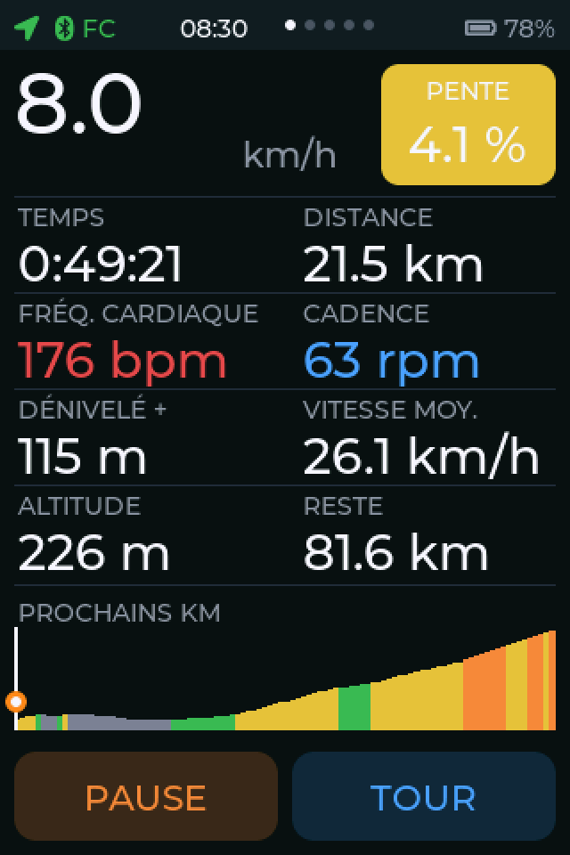
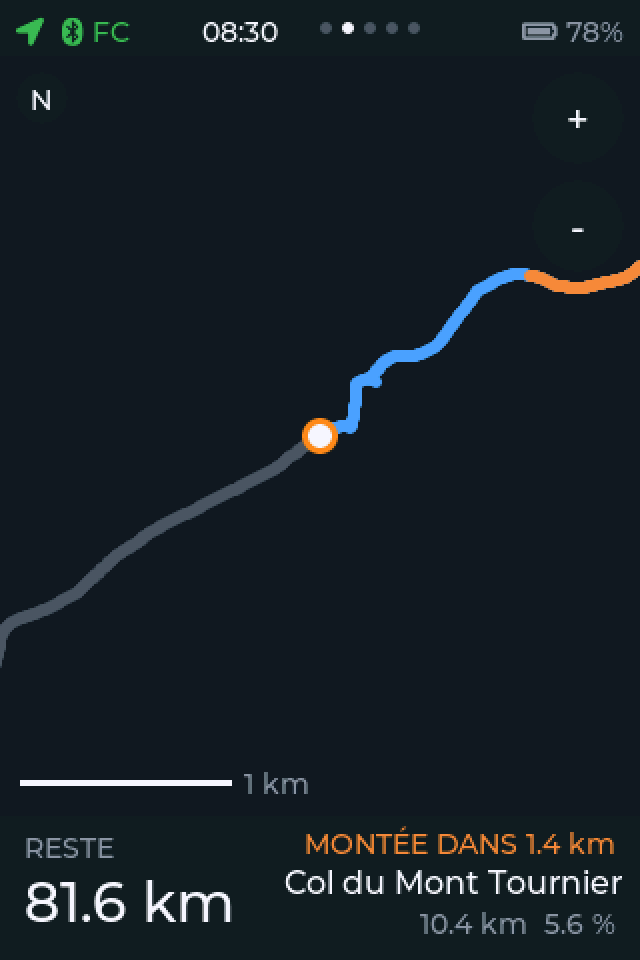
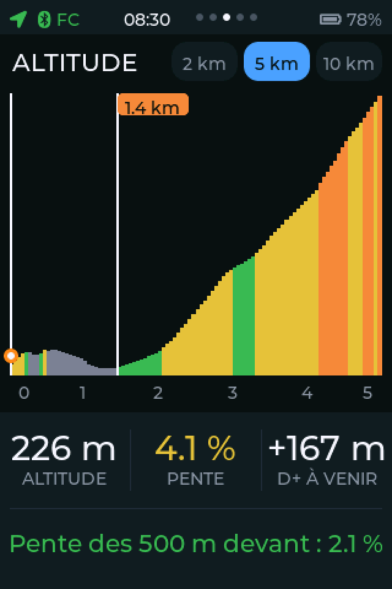
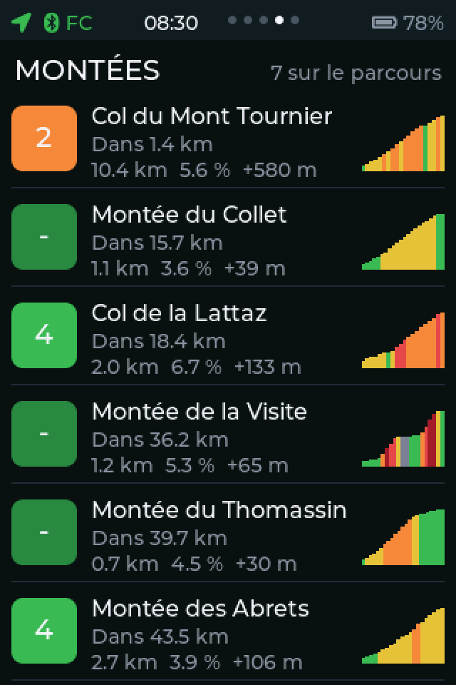
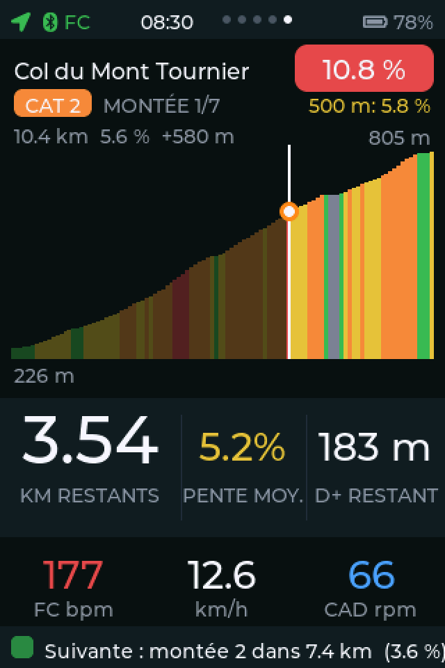

# GPS vélo

Compteur GPS vélo fait maison, avec les fonctions utiles des Garmin, Wahoo et COROS : enregistrement FIT pour Strava, trace GPX, profil des montées type ClimbPro avec noms de cols, écrans tactiles.

## État (octobre 2026)

Le code commun est écrit et testé **sur ordinateur**. Rien n'a encore tourné sur le matériel.

| Module | Rôle |
|---|---|
| `core/route` | Lecture d'un GPX en flux (sans allocation), mise à pas constant de 10 m |
| `core/matcher` | Position GPS sur la trace : distance depuis le départ, hors parcours, reprise après perte du signal |
| `core/climb` | Détection des montées, catégories (barème Garmin), pente par sections, valeurs restantes |
| `core/cols` | Noms des montées à partir d'une base locale de cols et de lieux (OpenStreetMap) |
| `core/fit` | Enregistrement d'une sortie au format FIT, avec récupération d'un fichier interrompu |
| `ui` | Écrans LVGL en portrait 320 x 480, navigation tactile (simulée sur PC) |

À faire : projet ESP-IDF pour la carte, acquisition GNSS, ceinture cardio (BLE), carte SD, envoi à Strava, fond de carte hors ligne, mise à jour en direct des écrans, changement de page automatique au début d'une montée. Détails dans `docs/avancement.md`.

## Matériel visé

Waveshare ESP32-S3-Touch-LCD-3.5 (écran tactile 3,5 pouces 320 x 480, 8 Mo de PSRAM), module GNSS u-blox MAX-M10S, baromètre I2C, batterie LiPo. Notes vérifiées sur la carte : `docs/carte_waveshare.md`.

## Structure

    core/    code C commun, sans dépendance (testé sur PC, destiné à ESP-IDF)
    ui/      écrans LVGL 9, polices avec accents, aperçu sur PC (build_preview.sh)
    tests/   tests sur PC, génération des données de rejeu
    tools/   convertisseur d'export OpenStreetMap vers la base de cols
    docs/    notes, captures d'écran

## Lancer les tests

Il faut gcc, make et python3 (avec `garmin-fit-sdk` et `fitdecode` pour la vérification des fichiers FIT : `pip install garmin-fit-sdk fitdecode`).
Place un GPX de test, avec heures et fréquence cardiaque, dans `tests/data/sortie.gpx`, puis :

    make test          # montées, noms, positionnement, enregistrement FIT
    make nommage       # facultatif : noms avec une vraie base dans tests/data/gps.csv
    sh ui/build_preview.sh   # aperçu des écrans, simule le toucher (télécharge LVGL 9.2.2)

## Aperçu des écrans

    

## Données personnelles

Le dépôt ne doit contenir **ni trace GPS ni fichier d'activité** : une sortie commence et finit souvent chez soi. Le `.gitignore` exclut `*.gpx` et `*.fit`. Les tests lisent un GPX fourni localement dans `tests/data/` (non publié).

## Licences et crédits

- Licence du code : à choisir.
- LVGL (interface) : voir son dépôt. Les polices de `ui/fonts` sont générées à partir de Montserrat (licence SIL OFL, à rappeler dans le dépôt).
- Données de cols et de lieux : © les contributeurs d'OpenStreetMap, licence ODbL. Le crédit doit apparaître dans l'appareil ou sa documentation.
- Le code n'est pas copié d'autres projets : les algorithmes de montées et de catégories s'appuient sur la documentation publique de Garmin et sur la lecture d'autres projets libres.
